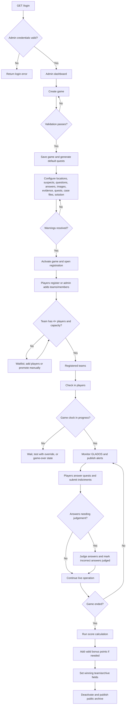

# Administrator game flow

This document traces the administrator journey from signing in, creating and configuring a game, opening registration, operating the live game, and closing/scoring/archiving it. It follows the current Laravel routes, middleware, controllers, models, views, and JavaScript. It documents success and failure branches, including implementation gaps that can affect successful completion.

`.env` files were not inspected and are outside the scope of this trace.

## 1. Admin authentication and access boundary

### Routes and middleware

- `GET /login` → `Auth\AdminLoginController::showLoginForm()` (`routes/web.php:95`).
- `POST /login` → `AdminLoginController::login()` (`routes/web.php:96`).
- `GET /logout` → `AdminLoginController::logout()` (`routes/web.php:97`).
- All admin routes are nested under `auth:admin` and `admin` (`routes/web.php:106-297`).
- Middleware aliases are registered in `bootstrap/app.php:25-37`:
  - `auth` → `App\Http\Middleware\Authenticate`.
  - `admin` → `App\Http\Middleware\Admin`.

### Login flow

`AdminLoginController` (`app/Http/Controllers/Auth/AdminLoginController.php`):

1. Uses Laravel’s `AuthenticatesUsers` trait (`:28`).
2. Redirects successful authentication to `/admin` (`:30-33`).
3. Uses the `admin` guard (`:42-45`) and Onyen as the username (`:47-50`).
4. Sends LDAP/fallback credentials using `samaccountname`, password, and fallback values (`:52-65`).
5. On failure, returns to the form with `Invalid Onyen or Password` (`:71-77`).

`Authenticate::handle()` (`app/Http/Middleware/Authenticate.php:18-36`) redirects an unauthenticated admin browser request to `/login` (`:24-30`). `Admin::handle()` (`app/Http/Middleware/Admin.php`) then applies the application’s admin-specific authorization check.

**Possible outcomes:**

- Valid admin credentials → `/admin`.
- Invalid credentials → login form with an error.
- Expired session/unauthenticated request → `/login`.
- Authenticated non-admin request → rejected by the `admin` middleware.

The route itself has no explicit `throttle:admin-login` middleware, although a limiter is defined in `App\Providers\AppServiceProvider.php:39-42`; therefore the configured limiter is not visibly applied to `POST /login` in `routes/web.php:96`.

## 2. Admin dashboard and shared navigation

`GET /admin` (`routes/web.php:111`) calls `AdminController::index()` (`app/Http/Controllers/Admin/AdminController.php:12-18`). It loads the homepage global alert and renders `admin.index`.

The dashboard provides links into:

- Games and game dashboards/settings.
- Locations, suspects, questions, evidence, minigame images, and Ghost DNA.
- Players and teams.
- Site messages and trash/recovery.

The entire admin resource set is listed under `routes/web.php:114-297`. A resource route can still return an empty/unimplemented action where the corresponding controller method is a stub; those gaps are called out below.

## 3. Create a game

### Open the create form

`GET /admin/game/create` is generated by the game resource route (`routes/web.php:189-199`) and calls `Admin\GameController::create()` (`app/Http/Controllers/Admin/GameController.php:36-41`). It creates an empty `Game` object and renders `resources/views/game/create.blade.php`.

### Submit game creation

`POST /admin/game` calls `GameController::store()` (`GameController.php:48-89`).

1. Validate:
   - `name` required (`:50-51`).
   - `start_time` required/date/after today (`:52`).
   - `end_time` required/date/after start (`:53`).
   - `max_teams` required integer (`:54`).
   - `students_only` required (`:55`).
2. Validation failure returns to the form with Laravel errors; no game or default quests are saved.
3. Create and save a `Game`, including name, start/end times, maximum teams, and student-only flag (`:58-64`).
4. Load all suspects and create a question quest for each suspect (`:66-84`).
   - Suspect ID 3 maps to location 4 (`:69-72`).
   - Suspect ID 4 maps to location 7 (`:73-75`).
   - Other suspects use their own ID as the location ID (`:76-78`).
5. Persist the generated quests through `game->quests()->saveMany()` (`:86`).
6. Redirect to the game dashboard (`:88`).

The `Game` model is `app/Game.php:13-72`; its relationships to teams, quests, evidence, alerts, and solution records are defined at `:78-136`.

**Failure/edge paths:**

- Invalid dates or missing required data stop creation before database writes.
- A missing suspect/location fixture can make generated quest configuration unusable; `store()` does not validate generated location IDs.
- `GameController::index()` is an empty method (`:26-29`), so the generated game resource index is not a useful listing endpoint; the admin dashboard/game links are the practical entry points.

## 4. Configure the game before activation

The game dashboard is `GET /admin/game/{id}` (`routes/web.php:189-199`) → `GameController::show()` (`GameController.php:97-119`). It eager-loads registered and waitlisted teams, solution objects, evidence, locations, quests, suspects, and quest locations (`:99-112`), computes warnings (`:114`), loads players for the game (`:116`), and renders `resources/views/game/dashboard.blade.php`.

The settings page is `GET /admin/game/{id}/edit` → `GameController::edit()` (`GameController.php:128-145`). It loads solution/evidence/quest data and all locations, then shows `game.edit`.

### Required readiness checks

`GameController::getWarnings()` (`GameController.php:546-578`) reports:

- No solution suspect (`:548-551`).
- No solution location (`:552-554`).
- No solution evidence (`:555-557`).
- No evidence-room location (`:558-560`).
- No geographic-investigation location (`:561-563`).
- Duplicate quest locations (`:565-570`).
- Duplicate quest suspects (`:571-575`).

Warnings are displayed to the administrator but are not a general server-side activation block. A game can therefore be activated with incomplete configuration; players may later encounter missing pages, empty choices, or an indictment that cannot succeed.

### Update game settings and content

`POST /admin/game/{id}` → `GameController::update()` (`GameController.php:154-203`):

1. Load the game or 404 (`:156`).
2. If case-file input exists, rebuild `case_file_items` from title/type/text arrays (`:158-169`). `Game::setCaseFileItemsAttribute()` JSON-encodes the value (`app/Game.php:214-220`).
3. If `evidence_list` exists, split IDs, clear the solution evidence if it is no longer in the list, detach current evidence, and attach the submitted IDs (`:170-177`).
4. Normalize date fields when submitted (`:178-183`).
5. If `registration == 1`, deactivate the current active game and set this game active (`:185-193`).
6. Copy matching request attributes to the model and save (`:195-201`).
7. Redirect back with “Game Updated” (`:203`).

**Important branches:**

- Opening registration also changes active-game state; it can silently deactivate another active game.
- The `start_time` normalization is nested under a second `if ($request->end_time)` (`:181`), so a start-only update may not be normalized as intended.
- The update loops over model attributes and accepts any matching request key (`:195-199`); admin forms must be treated as trusted, but this is a broad update surface.

## 5. Configure reusable game assets

These resources are available before or during game preparation through the admin routes.

### Locations

- Routes: `routes/web.php:201-212`.
- Controller: `app/Http/Controllers/Admin/LocationController.php`.
- Create/update validation requires name, integer floor, and map section (`LocationController.php:42-56`, `:79-93`).
- A location cannot be deleted if used by a quest or as an evidence/geographic location (`:102-114`).

### Suspects

- Routes: `routes/web.php:270-277`.
- `SuspectController::edit/update()` (`app/Http/Controllers/Admin/SuspectController.php:29-55`) loads and saves attributes. There is no create/delete route in this resource definition.
- Suspects drive default quest generation in `GameController::store()`.

### Questions and answers

- Routes: `routes/web.php:256-268`.
- `QuestionController::create()` (`app/Http/Controllers/Admin/QuestionController.php:55-61`) renders the question form.
- `QuestionController::store()` (`:68-112`) requires text, full answer, at least one answer, and location; optionally validates/uploads a JPEG/PNG/SVG image (`:71-90`), saves the question, and saves new/edited answers (`:95-109`).
- `QuestionController::edit/update()` (`:120-184`) updates question fields, optionally replaces the image, and saves answer changes.
- Deletion is blocked when the question has completed records (`:192-207`); otherwise answers, quest links, images, and the question are removed.
- Question listing supports location/game/search filters (`:19-47`).

### Minigame images

- Routes: `routes/web.php:214-224`.
- `MinigameImageController::store()` (`app/Http/Controllers/Admin/MinigameImageController.php:40-63`) requires name/year and optionally stores a validated image.
- Update follows the same required fields and image replacement path (`:84-106`).
- Delete is blocked when attached to quests (`:115-128`).

### Evidence

- Routes: `routes/web.php:135-145`.
- `EvidenceController::store()` (`app/Http/Controllers/Admin/EvidenceController.php:71-94`) requires a title and optionally stores an image with MIME/size validation.
- `update()` is at `:114-139`; delete is blocked when attached to any game (`:148-159`).
- The game-specific evidence page is `GameController::editEvidence()` (`GameController.php:280-289`), which loads attached/unattached evidence and locations.
- `POST /admin/game/{id}/import-evidence-room` calls `importEvidenceRoom()` (`GameController.php:298-319`): it requires a source game, copies evidence links, case-file items, and evidence location, and leaves the target unchanged when source and target IDs match.

## 6. Configure quests

Game creation creates question quests, but the administrator can edit each quest through the nested quest routes (`routes/web.php:245-254`).

`QuestController::edit()` (`app/Http/Controllers/Admin/QuestController.php:60-83`) loads the game, quest, suspect, location, attached questions/images, available questions for the quest location, and available minigame images.

`QuestController::update()` (`QuestController.php:91-131`):

1. Load quest and game (`:93-94`).
2. If changing a quest’s location/suspect, clear the corresponding game solution ID when it used the old value (`:96-107`).
3. Fill the quest and detach existing question/image links (`:110-113`).
4. For a question quest, parse `question_list` into ordered pivot records (`:114-123`).
5. For a minigame quest, attach IDs from `minigame_image_list` (`:124-126`).
6. Save and redirect to game edit (`:129-131`).

The admin JavaScript initializes quest drag/drop and type-specific setup in `resources/assets/js/app.js:84-91`; the implementation is in `resources/assets/js/clue.js:318-344` and `:393-399`.

**Configuration success condition:** every intended quest has the correct type, unique suspect/location, enough ordered questions or minigame images, and no warning from `getWarnings()`.

## 7. Open registration and manage teams

### Activate/deactivate

- `GET /admin/game/{id}/activate` → `GameController::activate()` (`routes/web.php:150`, `GameController.php:230-243`). It deactivates another active game, marks the requested game active, and redirects back.
- `GET /admin/game/{id}/deactivate` → `deactivate()` (`routes/web.php:151`, `GameController.php:252-259`). It sets `active = false` and redirects back.

The routes are GET-based even though they mutate state. This is an operational/CSRF risk: activation/deactivation should normally be POST/PUT/DELETE actions with CSRF protection.

Opening registration via `GameController::update()` also activates the game (`:185-193`). Registration itself is performed by players at `POST /enlist`, documented in `player-flow.md` and implemented by `RegistrationController::enlist()`.

### View teams

`GET /admin/game/{id}/teams` → `GameController::teams()` (`GameController.php:327-340`). It loads registered and waitlisted teams, their players, and renders `game.teams`.

### Add an admin-created team

`POST /admin/game/{id}/add-team` → `GameController::addTeam()` (`GameController.php:362-371`):

1. Require a team name (`:364`).
2. Create a `Team`, fill request fields, load the game, and associate/save the team (`:365-368`).
3. Redirect with a success alert (`:370`).

Because the `Team` migration defaults to waitlisted, an admin-created team needs members and/or an explicit waitlist toggle before it is registered.

### Edit team, waitlist, and members

- Team edit/update: `Admin\TeamController::edit/update()` (`app/Http/Controllers/Admin/TeamController.php:61-95`). Name is required; other matching attributes are copied from the request.
- Toggle registration: `toggleWaitlist()` (`:121-130`) flips `waitlist` and reports either “registered” or “moved to waitlist.” It does not check capacity or game ownership beyond the supplied team lookup.
- Add a player: `addPlayer()` (`:139-187`) supports an Onyen/LDAP player or a manual player with email, password, names, class, and academic group. It checks player warnings for LDAP players and supports `override_non_student` (`:147-162`), then attaches the player (`:181-184`).
- Remove a player: `removePlayer()` (`:196-202`) detaches the supplied player ID.
- Delete a team: `destroy()` (`:103-113`) detaches progress/player relationships, soft-deletes the team, and returns to the game team list.

**Admin-side branches/gaps:** the max-five check in `TeamController::addPlayer()` (`:143-145`) does not return after calling `redirect()`, so execution may continue. The admin team controller does not automatically set `waitlist = false` at four players; use the explicit toggle or player-side registration behavior.

## 8. Check in players before the event

1. `GET /admin/game/{id}/check-in` (`routes/web.php:174-176`) calls `GameController::checkIn()` (`GameController.php:481-486`) and renders registered teams/players in `game.checkin`.
2. The form can post a PID or use an optional player ID to `POST /admin/game/{id}/player/check-in/{playerId?}` (`routes/web.php:177`).
3. `checkInPlayer()` (`GameController.php:494-530`):
   - With a player ID, find by ID (`:496-498`). Otherwise require PID and find by PID (`:499-501`).
   - If not found, redirect with a danger alert (`:521-527`).
   - If found, intended duplicate detection is `if ($player->checked_id)` (`:503-510`), but the player model field is `checked_in`; this appears to be a bug, so the already-checked-in branch may not execute as intended.
   - Otherwise set `checked_in = true`, save, and return a success alert (`:511-519`).

Check-in is not required by the player middleware, but `UiController::questStatus()` counts `checkedInPlayers` for its completion message (`app/Http/Controllers/UiController.php:373-394`).

## 9. Monitor and communicate during the live game

### Alerts

- `POST /admin/game/{id}/alert` uses `AlertController::store()` (`app/Http/Controllers/Admin/AlertController.php:17-27`). It requires a string message up to 255 characters, associates it with the game, saves, and returns to the dashboard.
- The player retrieves alerts through `UiController::alert()` and marks them seen through `UiController::seen()` (`app/Http/Controllers/UiController.php:418-449`).
- Delete uses `AlertController::destroy()` (`:37-43`).

### GLADOS viewing/status

- `GET /admin/game/{id}/glados/viewing` → `GladosController::viewing()` (`app/Http/Controllers/Admin/GladosController.php:22-50`). It counts recent `viewing` rows updated within 30 minutes and groups routes, including quest names/locations.
- `GET /admin/game/{id}/glados/status` → `GladosController::status()` (`:59-65`). It loads registered teams and quest completion pivots and renders team progress.
- The view rows are written by the `layouts.ui` view composer in `AppServiceProvider.php:77-99` whenever an authenticated player renders a UI page.

### Test a game before its clock starts

`GET /test-game` (`routes/web.php:109`) calls `GameController::overrideInProgress()` (`GameController.php:538-544`). It takes the active game, pushes its ID into `session.override_in_progress`, and redirects to the player UI. `InProgressGame` honors that session value (`app/Http/Middleware/InProgressGame.php:19-23`). This is an admin-only test bypass and should not be exposed to unauthorized users.

## 10. Judge answers and complete quest records

Some question answers may require admin judgement.

1. `GET /admin/game/{id}/judgement` → `GameController::judgement()` (`GameController.php:379-385`) loads the game’s quests and renders `game.judgement`.
2. The judge posts `POST /admin/game/{id}/judge/{questId}/{questionId}/{teamId}` (`routes/web.php:162-167`) to `judgeAnswers()` (`GameController.php:395-412`).
3. Require a `judgement` value (`:397`).
4. Load the team by URL team ID (`:398`).
5. If judgement is `correct`, attach the question to the team and, after more than two correct questions, attach the quest (`:400-407`).
6. Mark the team/question’s incorrect answers judged (`:409`) and return to the prior page (`:411`).

The endpoint validates URL shapes as numeric but does not visibly confirm that the supplied quest, question, and team all belong to the route’s game. This is an authorization/data-integrity risk for admin users and should be tightened.

## 11. Score the completed game

`GET /admin/game/{id}/score/{includeWaitlist?}` (`routes/web.php:170-172`) calls `GameController::score()` (`GameController.php:420-453`).

1. Load scoring configuration and the game solution (`:422-423`).
2. Use registered teams by default, or waitlisted teams when the optional parameter equals `waitlist` (`:424-426`).
3. If the game is active, calculate scores for teams ordered by indictment time (`:428-443`):
   - Correct-question count × configured question value (`:433`).
   - DNA count and DNA pair count × configured DNA value (`:434-435`).
   - Correct indictment receives the current time bonus, then the bonus decrements for the next correct indictment (`:436-440`).
   - Save `team.score` (`:441`).
4. Partition correct indictments before incorrect indictments and sort each group by descending score (`:445-451`).
5. Render `game.score` (`:453`).

### Add bonus points

`POST /admin/game/{id}/bonus-points` (`routes/web.php:169`) calls `bonusPoints()` (`GameController.php:461-473`). It requires an existing team ID and integer points, increments `bonus_points`, saves, and redirects to the score page.

The controller validates team existence but does not visibly constrain the team to the route’s game. An admin can therefore accidentally apply a bonus to another game’s team if given the wrong ID.

## 12. Archive and publish the completed game

### Set archive data

`GET /admin/game/{id}/archive` → `GameController::editArchive()` (`GameController.php:267-271`) loads registered teams and the winning team and renders `game.archiveData`.

The archive form uses the game update/archive paths to set post-game fields such as archive status, winning team, accolades, and special thanks. The exact form is in `resources/views/game/archiveData.blade.php`.

### Public result

`GET /archive/{id}` is public (`routes/web.php:32`) and calls `WebController::archive()` (`app/Http/Controllers/WebController.php:57-75`):

1. Load the game’s registered teams and players (`:59`).
2. Split teams into correct and incorrect indictments (`:62-68`).
3. Sort each group by score and select first/second/third place (`:69-73`).
4. Render `web.archive` (`:75`).

### Deactivate and preserve history

- `GameController::deactivate()` sets `active = false` (`GameController.php:252-258`).
- `GameController::destroy()` soft-deletes a game and its teams/quests (`GameController.php:212-221`).
- Admin trash lists soft-deleted games (`AdminController.php:20-24`).
- Restore restores game, teams, and quests (`AdminController.php:27-35`).
- Permanent delete attempts to detach pivots, force-delete teams/quests/game, and return to admin (`AdminController.php:37-58`). The code uses `detatch()` at `:48-50`, which appears misspelled and may fail during permanent deletion.

## 13. End-to-end successful administrator path

An administrator successfully completes a game when this sequence succeeds:

1. Login through `/login` with the admin guard.
2. Create a game with valid future start/end times, team capacity, and student setting.
3. Confirm generated quests have valid, unique suspects/locations.
4. Create or verify locations, suspects, questions/answers, minigame images, and evidence.
5. Configure every quest and its ordered content.
6. Configure evidence room, case-file items, geographic location, and the solution.
7. Resolve all `getWarnings()` output.
8. Activate the game and open registration.
9. Allow player-created teams, or create/manage teams administratively; move valid teams off the waitlist.
10. Check in players as needed.
11. During the live window, monitor GLADOS, publish alerts, and judge answers requiring review.
12. After teams submit indictments and the game ends, run the score view and add any legitimate bonus points.
13. Set the winning team/archive data, deactivate the game, and verify the public archive page.

## 14. Full branch summary

| Stage | Success | Alternate/failure path |
|---|---|---|
| Admin login | Admin guard authenticates and redirects `/admin` | Invalid credentials return to login; missing auth redirects `/login` |
| Game creation | Valid game saved and default quests generated | Validation failure; generated location/suspect configuration may be invalid |
| Readiness | Warnings cleared | Game can still be activated with missing solution/evidence/location configuration |
| Registration | Active game with registration flag accepts players | Closed/no active game redirects or returns `enlist.no_game` |
| Team capacity | Four-player team with available spot becomes registered | Fewer than four or full capacity remains waitlisted |
| Admin team setup | Team/member changes save | Manual team max check has missing return; waitlist toggle is manual |
| Activation | One game is active | Activating one deactivates another; GET mutation is a security/CSRF concern |
| Check-in | Player `checked_in` set true | Unknown PID alert; duplicate check branch likely broken by `checked_id` typo |
| Live monitoring | Alerts and GLADOS show current state | Viewing stats only cover last 30 minutes; empty totals may create percentage edge cases |
| Judgement | Correct answers/quests attached and incorrect answers judged | Cross-record ownership is not visibly validated |
| Scoring | Scores calculated and correct indictments ranked first | Active flag controls recalculation; waitlist inclusion is optional |
| Archive | Public archive shows ranked teams | Soft-delete/restore available; permanent delete has likely `detatch()` typo |

## Administrator flow chart

