# Player game flow: code-level trace

This is the code-level trace of a player journey from team creation through registration, game play, indictment, and game completion. It includes the runtime path, persistent state, branch behavior, and the source locations that implement each step.

All paths below describe the current code after the `teamId` regression fix. `.env` files are intentionally excluded from this analysis.

## Architecture and request boundaries

### Route and middleware registration

- `bootstrap/app.php:18-37` registers `routes/web.php` and aliases the custom middleware:
  - `activeGame` → `App\Http\Middleware\ActiveGame`
  - `auth` → `App\Http\Middleware\Authenticate`
  - `inProgressGame` → `App\Http\Middleware\InProgressGame`
  - `player` → `App\Http\Middleware\Player`
  - `validTeam` → `App\Http\Middleware\ValidTeam`
- `routes/web.php:40-89` wraps the player-facing registration, game, and team-management routes in `activeGame`.
- `routes/web.php:51-78` wraps game UI routes in `auth:player`, `player`, and `validTeam`; routes that require the clock to be running are additionally wrapped in `inProgressGame`.
- `routes/web.php:84-87` exposes team management after player authentication, but outside `validTeam`.
- `routes/web.php:99-101` defines player login (`GET/POST /go`) and logout (`POST /leave`).

### Shared runtime state

| State | Created/updated by | Used by |
|---|---|---|
| `session.gameId` | `ActiveGame::handle`, `InProgressGame::handle` | Registration, current-game queries, UI controllers |
| `session.teamId` | `ValidTeam::handle` when absent; cleared when invalid | Validated team selection for protected UI requests |
| `request.attributes.currentTeam` | `ValidTeam::handle` | `UiController::currentTeam()` |
| Player auth guard | `RegistrationController::enlist`, `LoginController` | `auth:player`, `player`, team lookup |
| `teams.waitlist` | Team migration default, registration/add/remove controllers, admin toggle | Capacity and registration status |
| Team progress pivots | `UiController` answer/minigame/DNA methods | Dashboard progress, quest status, scoring |

## End-to-end flow

## 0. Administrator creates a playable game

This is a prerequisite rather than a player action.

1. `Admin\GameController::store()` (`app/Http/Controllers/Admin/GameController.php:48-89`) validates game name, future start time, end time, maximum teams, and student-only setting.
2. It saves a `Game` (`app/Game.php:13-72`) and creates one question quest per suspect (`GameController.php:66-86`).
3. Administrators configure quests, questions, answers, minigame images, evidence, locations, case-file items, and the solution through the admin controllers/views.
4. `Admin\GameController::update()` (`GameController.php:154-203`) activates a game when registration is opened and deactivates the previous active game.
5. `Admin\GameController::activate()` (`GameController.php:230-243`) explicitly activates a game.
6. The game must have a solution suspect, location, and evidence plus evidence/geographic locations. `GameController::getWarnings()` (`GameController.php:546-578`) reports missing configuration.
7. Optional player check-in is handled by `GameController::checkInPlayer()` (`GameController.php:494-531`), which sets `players.checked_in`. This is used by quest status messaging, not as a player-route authorization requirement.

Relevant model behavior:

- `Game::active()` and `Game::inProgress()` are defined at `app/Game.php:141-151`.
- `Game::spots_left` counts non-waitlisted teams at `app/Game.php:166-174`.
- `Game::solution` exposes the configured three-part solution at `app/Game.php:204-212`.
- `Team::MINIMUM_PLAYERS = 4` and the `waitlist` cast are at `app/Team.php:12-16` and `48-56`.
- `Team::registered()` and `Team::waitlist()` are at `app/Team.php:186-196`.

## 1. Select the active game and open enlistment

### Request path

1. Player visits `/` (`routes/web.php:31`). `WebController::index()` (`app/Http/Controllers/WebController.php:20-48`) loads the active game, agents, archives, and homepage/registration notices.
2. Player visits `GET /enlist` (`routes/web.php:45`). The outer `activeGame` middleware runs first.
3. `ActiveGame::handle()` (`app/Http/Middleware/ActiveGame.php:18-32`) checks `session.gameId`:
   - If absent and an active game exists, it stores that game ID.
   - If no active game exists, it logs out the player guard and redirects to `player.login.form` (`/go`).
4. `RegistrationController::index()` (`app/Http/Controllers/RegistrationController.php:20-28`) loads the session game:
   - `game.registration` true → renders `resources/views/web/registration/enlist.blade.php`.
   - Registration false → redirects to `/`.

### View and form

`web/registration/enlist.blade.php:12-56`:

- Shows a full-capacity message when `game.spots_left == 0` (`:13-18`).
- Displays validation errors (`:19-31`).
- Posts `teamName` and `onyen` to `enlist.submit` (`:42-56`).
- Displays student-only or prior-participation certification based on `game.students_only` (`:37-41`).

## 2. Create the team and attach the initial player

### Request path

`POST /enlist` is routed at `routes/web.php:46` and throttled with the `registration` limiter.

`AppServiceProvider::boot()` (`app/Providers/AppServiceProvider.php:49-51`) limits registration to five requests per minute per IP.

`RegistrationController::enlist()` (`app/Http/Controllers/RegistrationController.php:139-184`) executes:

1. Validate required `onyen` and `teamName` (`:142-146`). Failure redirects back with old input/errors.
2. Query the newest active game with registration enabled and eager-load registered teams (`:150-152`). If absent, return `enlist.no_game` (`:153-155`).
3. Reuse or instantiate a `Player` based on Onyen (`:157-160`).
4. Refresh identity/student fields with `Player::updateFromOnyen()` (`app/Player.php:146-182`), which validates LDAP identity and copies name, PID, email, academic group, class, and student status.
5. Run `Player::getWarnings($game)` (`app/Player.php:189-217`). Any warning returns to the form (`RegistrationController.php:162-166`):
   - LDAP Onyen not found (`Player.php:193-195`).
   - Player was previously checked in (`:197-200`).
   - Player already has a team for the game (`:202-208`).
   - Student-only game and player is not a student (`:210-214`).
6. On success, save the player (`:168`), create a `Team`, set its name/game, save it, and attach the player (`:170-176`).
7. Send the initial registration email (`:178-179`; `emailTeam()` at `RegistrationController.php:186-199`).
8. Authenticate the player through the `player` guard (`:181`) and redirect to `GET /team` (`:183`).

The team starts with the migration default `waitlist = true` (`database/migrations/2017_01_03_142752_create_teams_table.php:22`). A one-player team is therefore not yet registered.

## 3. Manage the team until registration

### Team management lookup

`GET /team` is routed at `routes/web.php:84` and handled by `RegistrationController::teamManagement()` (`RegistrationController.php:33-63`). It:

1. Loads the session game (`:35`).
2. Gets the authenticated player (`:36`).
3. Finds the player’s first active team with players loaded (`:37`).
4. No team → logs out and redirects to `/go` (`:39-43`).
5. Chooses a status message based on waitlist state, player count, and spots remaining (`:45-58`).
6. Computes whether removal is allowed in the UI: waitlisted teams or teams with more than four players may remove members (`:60`).
7. Renders `web/registration/team_management.blade.php` (`:62`).

### Add player

`POST /team/add-player` (`routes/web.php:86`) calls `RegistrationController::addPlayer()` (`RegistrationController.php:79-118`):

1. Require `onyen` (`:81-83`).
2. Load the session game with registered teams and the authenticated player’s active team (`:85-88`).
3. Reject teams with five players (`:90-93`).
4. Reuse/create the player, refresh from LDAP, and run `getWarnings()` (`:95-103`). All eligibility failures return without attachment.
5. Save and attach the player (`:106-109`).
6. If the team reaches four players and `spots_left > 0`, set `waitlist = false` and send the fully-registered email (`:110-115`). Otherwise it remains waitlisted.
7. Redirect to team management (`:117`).

### Remove player

`POST /remove-player/{playerId}` (`routes/web.php:87`) calls `removePlayer()` (`RegistrationController.php:120-132`):

1. Load the player or fail (`:122`).
2. Find the authenticated player’s active team (`:123-125`) and detach the selected player.
3. If fewer than four remain, set `waitlist = true` (`:126-129`).
4. Redirect to team management (`:131`).

The Blade view (`team_management.blade.php:43-53`, `:89-102`) hides remove buttons for exactly-four-player registered teams, but the controller does not enforce that UI rule server-side.

### Edit team details

`POST /team` (`routes/web.php:85`) calls `updateTeam()` (`RegistrationController.php:65-77`):

- Requires a name (`:67-69`).
- Finds the authenticated player’s active team (`:70-71`), fills/saves it (`:73-74`), and redirects back (`:76`).
- The view only displays the edit form before three days before game start (`team_management.blade.php:113-140`); the controller does not enforce that cutoff.

The management UI and status branches are implemented at `resources/views/web/registration/team_management.blade.php:12-140`.

## 4. Authenticate and authorize game access

### Login

1. `GET /go` is handled by `Auth\LoginController::showLoginForm()` from Laravel’s authentication trait and rendered through `resources/views/auth/login.blade.php` and `web/_login_form.blade.php`.
2. `POST /go` is routed at `routes/web.php:100` and throttled with `player-login`.
3. `LoginController` (`app/Http/Controllers/Auth/LoginController.php:28-65`) uses `AuthenticatesUsers`, the `player` guard (`:42-45`), Onyen as username (`:47-50`), and LDAP/fallback credentials (`:52-65`).
4. Failed login returns `Invalid Onyen or Password` via `sendFailedLoginResponse()` (`:77-84`).
5. Successful login redirects to `/start` (`:30-33`).
6. Login throttling is configured at `AppServiceProvider.php:44-47` (10 per minute per Onyen/IP).

### Middleware sequence

For `GET /start` and protected game requests, the route nesting in `routes/web.php:40-78` results in:

1. `ActiveGame::handle()` ensures `session.gameId` (`ActiveGame.php:18-32`).
2. `Authenticate::handle()` (`app/Http/Middleware/Authenticate.php:18-36`) requires the specified guard and redirects browser requests to `/go`; Ajax/JSON requests receive 401 (`:20-31`).
3. `Player::handle()` (`app/Http/Middleware/Player.php:12-19`) repeats the player guard check and redirects to `/` if missing.
4. `ValidTeam::handle()` (`app/Http/Middleware/ValidTeam.php:21-58`) establishes the secure team context.
5. `InProgressGame::handle()` (`app/Http/Middleware/InProgressGame.php:17-34`) runs for gameplay endpoints and redirects to `/game-over` when no active game is within its start/end window.

### Fixed `teamId` flow and security behavior

`ValidTeam` is the fix for the historical regression:

1. Read authenticated player, `session.gameId`, and `session.teamId` (`ValidTeam.php:23-25`).
2. Build a query scoped to `teams.game_id = gameId`, a `players` membership match for the authenticated player, and `deleted_at IS NULL` (`:30-35`). Session data is treated only as a selector, not as authorization.
3. If `teamId` exists, constrain the scoped query by that ID (`:37-39`). A stale, cross-game, deleted, or foreign team fails.
4. If `teamId` is absent, select the first matching team ordered by ID (`:40-43`) and persist only its validated ID (`:44-46`).
5. If no matching team exists, clear the session value, log out, and redirect to `/go` (`:49-54`).
6. On success, put the validated team in `request.attributes.currentTeam` (`:56`) and continue.

The historical cause is commit `4e4ae6b`, which removed the old missing-session fallback while adding authorization checks. The current middleware restores the fallback without restoring the old trust issue.

## 5. Dashboard and navigation

`GET /start` is routed at `routes/web.php:53` to `UiController::index()` (`app/Http/Controllers/UiController.php:26-76`).

1. Load session game with quests, suspects, and questions (`:28`).
2. If the admin test override session exists, widen the game time window (`:29-32`).
3. Read the already-authorized `currentTeam` and load correct questions, completed quests, and DNA (`:34-35`).
4. Build progress for each quest (`:37-73`): question quests count correct answers; minigames use completed quest membership.
5. Render `resources/views/ui/index.blade.php` (`:75`).

The dashboard exposes suspect quests, map, evidence, indictment, and info via `ui/index.blade.php:16-85`. Navigation/logout are in `resources/views/ui/_nav.blade.php:7-17`.

The UI layout (`resources/views/layouts/ui.blade.php:9-23`) includes the page content and alert modal. `AppServiceProvider`’s `layouts.ui` composer (`app/Providers/AppServiceProvider.php:77-99`) records player page viewing for the current in-progress game.

## 6. Complete suspect quests

### Quest page dispatch

`GET /game/quest/{id}` is routed at `routes/web.php:57` to `UiController::quest()` (`UiController.php:137-152`).

1. `questForCurrentGame()` (`UiController.php:469-475`) restricts the quest to `session.gameId`.
2. Load the suspect and team (`:139-142`).
3. Question quests load team question/completed-quest relations; minigames load minigame images (`:143-150`).
4. `resources/views/ui/quest.blade.php:5-18` chooses `_question_interface` or `_minigame_interface` based on `$quest->type`.

### Question quest

Source locations:

- Rendering: `resources/views/ui/_question_interface.blade.php:1-25`.
- Form: `resources/views/ui/_question_form.blade.php`.
- Browser setup: `resources/assets/js/app.js:40-43` and `resources/assets/js/clue.js:280-304`.
- Server endpoint: `routes/web.php:64` → `UiController::attemptQuestion()` (`UiController.php:225-255`).
- Completion status: `UiController::questStatus()` (`UiController.php:371-410`).

Runtime flow:

1. Already-completed questions render as “Complete” (`_question_interface.blade.php:2-6`).
2. Otherwise the player submits the answer form. JavaScript prevents normal submission, marks the question submitting, and sends serialized form data by Ajax (`clue.js:281-301`).
3. The endpoint requires `attempt` (`UiController.php:227-229`) and obtains the authorized team (`:230-233`).
4. It loads only a question attached to a quest in the current game through `questionForCurrentGame()` (`:232-233`, `:480-484`).
5. It builds a case-insensitive answer regex from configured answers (`:236`).
6. Incorrect answer → create an `incorrect_answers` row for the team (`:245-249`) and return a message. JavaScript displays the retry state (`clue.js:291-296`, `:411-418`).
7. Correct answer → attach the team to the question if not already attached (`UiController.php:239-243`), return `{correct:true}`, and replace the question UI with “Complete” (`clue.js:291-294`, `:401-408`).
8. `questStatus` loads completed questions for the quest (`:382-386`). When `correct > 2`, it attaches the quest to the team and returns `complete` (`:388-397`). Fewer than three leaves it incomplete.

The answer route has `throttle:game-actions` (`routes/web.php:64`), configured at `AppServiceProvider.php:53-56` for 60 requests/minute per authenticated player/IP.

### Minigame quest

Source locations:

- Rendering/order input: `resources/views/ui/_minigame_interface.blade.php:1-35`.
- Browser drag/drop and submit: `resources/assets/js/clue.js:231-277`, especially `updateMinigameOrder()` at `:430-441`.
- Server endpoint: `routes/web.php:66` → `UiController::attemptMinigame()` (`UiController.php:263-283`).

Runtime flow:

1. Images render shuffled with IDs in `data-id` (`_minigame_interface.blade.php:17-23`).
2. Sortable updates the hidden `attempt` input to the ordered IDs (`clue.js:239-245`, `:430-441`).
3. Ajax submits to `/attempt/minigame/{id}` (`clue.js:253-276`).
4. Server requires `attempt`, loads the current-game quest and images, and computes both ascending and descending year orders (`UiController.php:265-273`).
5. Wrong order returns an empty JSON object; the browser displays retry feedback (`clue.js:266-271`).
6. Correct ascending or descending order attaches the authorized team to the quest and returns `{correct:true}` (`UiController.php:277-283`).
7. `questStatus()` recognizes the completed quest in its minigame branch (`UiController.php:399-405`).

### Optional DNA path

The dashboard link is commented out (`resources/views/ui/index.blade.php:49-57`) and navigation is commented out (`resources/views/ui/_nav.blade.php:10-12`), but routes remain:

- `GET /game/dna` → `UiController::dna()` (`routes/web.php:61`, `UiController.php:291-304`).
- `POST /attempt/dna` → `attemptDna()` (`routes/web.php:65`, `UiController.php:312-337`).

The endpoint validates a sequence, avoids duplicate team attachment, and attaches valid DNA to the authorized team. DNA is not required for indictment.

## 7. Evidence room and evidence selection

### Evidence page

`GET /game/evidence` (`routes/web.php:58`) calls `UiController::evidence()` (`UiController.php:112-118`):

1. Loads the authorized team’s evidence relation (`:114`).
2. Loads current game evidence and evidence location (`:115`).
3. Renders `resources/views/ui/evidence.blade.php`.

The view displays case-file modals and evidence options (`ui/evidence.blade.php:17-25`, `:27-45`).

### Evidence POST

`POST /set/evidence` (`routes/web.php:67`) calls `UiController::setEvidence()` (`UiController.php:345-362`):

1. Get the authorized team/current game (`:347-348`).
2. Require an integer evidence ID (`:350-352`).
3. Query evidence through the current game’s many-to-many relation (`:354-356`), preventing selection of an unrelated game’s item.
4. Associate evidence, set `evidence_selected_at`, and save (`:358-360`).

Evidence may be changed until indictment. The view hides the form after `team->indictment_made` (`ui/evidence.blade.php:27-45`).

## 8. Geographic investigation

`GET /game/geographic-investigation` (`routes/web.php:59`) calls `UiController::geographicInvestigation()` (`UiController.php:125-130`). It loads and displays the configured geographic-investigation location. There is no separate player submission or completion mutation for this page.

## 9. Indictment and completion

### Indictment form

`GET /game/indictment` (`routes/web.php:71`) calls `UiController::indictment()` (`UiController.php:160-181`).

1. Load authorized team with completed quests/evidence/current choices (`:162`).
2. Load current game quests (`:163`).
3. Add warning entries for incomplete quests (`:165-172`) and missing evidence (`:174-179`). These warnings are advisory.
4. Render `resources/views/ui/indictment.blade.php`, which chooses the saved-indictment display or form (`:8-12`).
5. The form renders suspect/location/evidence choices in `_indictment_form.blade.php:16-41` and confirms through a modal (`:43-67`).
6. Browser initialization is registered at `resources/assets/js/app.js:45-46`; submission behavior is in `resources/assets/js/clue.js:220-228`.

### Indictment POST

`POST /game/indictment` (`routes/web.php:60`) calls `UiController::setIndictment()` (`UiController.php:189-217`):

1. Get the authorized team (`:191`).
2. Require integer suspect, location, and evidence IDs (`:192-196`).
3. Load the current game from the session (`:198`).
4. Compare all three IDs against `game.suspect_id`, `location_id`, and `evidence_id` (`:199-204`). A mismatch aborts with HTTP 422 and does not save.
5. Save the three selected IDs and `indictment_time` (`:206-214`). If evidence was not previously recorded, set a fallback evidence timestamp (`:209-211`).
6. Redirect to the dashboard (`:216`).

Success is therefore a correct saved indictment, not a separate “win” record. `Team::indictment_correct` (`app/Team.php:71-87`) later compares the saved team choices to the game solution.

The dashboard’s post-indictment message (`resources/views/ui/_indictment_complete.blade.php:1-10`) explicitly tells the team it can continue answering questions for points.

## 10. Game end, score, and exits

- `InProgressGame::handle()` (`app/Http/Middleware/InProgressGame.php:17-34`) chooses the override game when present, otherwise the active in-progress game. If none exists, redirect to `gameover`.
- `/game-over` is a public route rendering `resources/views/errors/game_over.blade.php` (`routes/web.php:33-35`).
- The dashboard also displays an ended-game message when `game->inProgress` is false (`resources/views/ui/index.blade.php:6-13`).
- Player logout is a POST form in `ui/_nav.blade.php:13-17`, routed to `LoginController` logout at `routes/web.php:101`.
- Admin scoring is handled by `Admin\GameController::score()` (`app/Http/Controllers/Admin/GameController.php:420-453`), which groups correct indictments before incorrect ones and sorts by score. This is not a player-facing completion transition.

Failure/recovery branches:

| Condition | Code path | Result |
|---|---|---|
| No active game | `ActiveGame::handle()` `:20-25` | Logout and `/go` |
| Registration closed | `RegistrationController::index()` `:22-27` | Redirect `/` |
| Invalid registration data | `RegistrationController::enlist()` `:142-166` | Return form with errors |
| Team has too many players | `RegistrationController::addPlayer()` `:90-93` | Return with full-team error |
| Team falls below four | `RegistrationController::removePlayer()` `:126-129` | Set waitlist true |
| Invalid login | `LoginController::sendFailedLoginResponse()` `:77-84` | Return login error |
| No matching authorized team | `ValidTeam::handle()` `:49-54` | Clear team session, logout, `/go` |
| Invalid existing `teamId` | `ValidTeam::handle()` `:37-39`, `:49-54` | Reject; never switch silently |
| Game not in progress | `InProgressGame::handle()` `:22-27` | `/game-over` |
| Incorrect question | `UiController::attemptQuestion()` `:245-249` | Record incorrect answer; retry |
| Incorrect minigame order | `UiController::attemptMinigame()` `:277-283` | Empty response; retry |
| Invalid evidence ID | `UiController::setEvidence()` `:354-356` | Lookup failure |
| Wrong indictment | `UiController::setIndictment()` `:199-204` | HTTP 422; revise selection |

## Player journey flow chart

```mermaid
flowchart TD
    A[Visit homepage] --> B{Active game and registration open?}
    B -- No --> B1[Registration page redirects home or player is sent to login]
    B -- Yes --> C[Open enlistment form]
    C --> D[Submit team name and initial Onyen]
    D --> E{Required fields valid?}
    E -- No --> C
    E -- Yes --> F[Look up Onyen and refresh player from LDAP]
    F --> G{Player eligible for this game?}
    G -- No: invalid, checked in, duplicate, or not student --> C
    G -- Yes --> H[Create team and attach initial player]
    H --> I[Authenticate player and open team management]
    I --> J{At least 4 eligible players and a spot available?}
    J -- No --> K[Remain on waitlist]
    K --> L{Add/replace eligible players or await/admin promotion}
    L --> J
    J -- Yes --> M[Team becomes registered]
    M --> N[Player logs in when game starts]
    N --> O{Credentials valid?}
    O -- No --> N
    O -- Yes --> P[ValidTeam verifies or securely selects teamId for player and game]
    P --> Q{Team authorization valid?}
    Q -- No --> Q1[Clear session team, log out, return to player login]
    Q -- Yes --> R{Game in progress?}
    R -- No --> R1[Game-over screen]
    R -- Yes --> S[Open game dashboard]
    S --> T[Complete each suspect quest]
    T --> T1{Quest type?}
    T1 -- Questions --> T2[Answer questions; retry incorrect answers]
T2 --> T3{At least 3 correct in quest?}
T3 -- No --> T2
T3 -- Yes --> U[Quest complete]
T1 -- Minigame --> T4[Arrange images chronologically]
T4 --> T5{Order correct?}
T5 -- No --> T4
T5 -- Yes --> U
U --> V{All required quests complete?}
V -- No --> T
V -- Yes --> W[Select evidence from evidence room]
W --> X[Choose suspect, portal location, and evidence]
X --> Y{Indictment matches game solution?}
Y -- No --> X1[422 rejection; revise indictment]
X1 --> X
Y -- Yes --> Z[Indictment saved; game completed successfully]
Z --> AA[Continue answering for points until end time]
AA --> AB[Game ends; report back to lobby]

classDef failure fill:#f8d7da,stroke:#842029,color:#58151c;
class B1,C,Q1,R1,X1 failure;
```

