# Player game flow

This document traces the player-facing flow from creating a team through registration, entering the game, completing its activities, and submitting an indictment. It follows the current Laravel routes, middleware, controllers, models, Blade views, and game JavaScript.

> **Implementation note:** `ValidTeam` now securely derives `teamId` when it is absent by querying for a team owned by the authenticated player in the current game. A supplied `teamId` is still revalidated and is never trusted by itself.

Git history shows the missing fallback was a regression: before commit `4e4ae6b` (`Ensure that players and game components are restricted to their own team and the current game`), `ValidTeam` automatically selected the authenticated player’s first active team and stored its ID in the session. The current implementation restores that behavior while adding current-game and player-membership validation.

## Actors and state

- **Player:** authenticated through the `player` guard using an Onyen and password/LDAP credentials.
- **Team:** belongs to one game and has one or more players. `Team::MINIMUM_PLAYERS` is 4; the registration UI permits at most 5 players.
- **Game:** must be active for registration and must be active and within `start_time`/`end_time` for in-game actions.
- **Registration state:** new teams default to `waitlist = true`. A team becomes registered when it reaches four players while a spot is available. `Game::spots_left` counts registered (non-waitlisted) teams against `max_teams`.
- **Game progress:** question answers are stored in `question_team`; completed quests in `quest_team`; selected evidence and indictment values are stored on the team.

## 0. Administrator prerequisites

Before a player can complete the flow, an administrator normally:

1. Creates a game with a future start time, end time, maximum team count, and student-only setting.
2. The game creation process creates one question quest per suspect. The administrator configures questions, answers, quest types/locations, evidence, evidence-room location, geographic-investigation location, case-file items, and the solution (suspect, location, evidence).
3. Activates the game. Opening registration also activates it and deactivates the previously active game.
4. Enables the game’s `registration` flag. Only an active game with registration enabled is accepted by the enlist POST.
5. Optionally checks players in through the admin check-in screen. Check-in sets `players.checked_in`; it is used for quest status messaging, but the player route guards do not require it.

If no active game exists, the `activeGame` middleware logs out the player and redirects to `/go` for requests under the active-game route group. If the game is not in progress, in-progress routes redirect to `/game-over`.

## 1. Find the enlistment page

1. The player visits `/` and sees the active game and registration/process information.
2. `GET /enlist` runs through `activeGame`:
   - If the session has no `gameId`, the middleware stores the current active game ID.
   - If there is no active game, the player is logged out and sent to the player login form.
3. `RegistrationController@index` loads the session game.
   - If `game.registration` is true, it renders `web.registration.enlist`.
   - If registration is closed, it redirects to `/`.

## 2. Create a team and register the initial player

The enlist form submits `POST /enlist` with `teamName` and `onyen`.

### Validation and game-selection branches

- Missing `teamName` or `onyen`: Laravel validation fails and returns to the form with errors and old input.
- The active registration game is looked up independently of the session using the newest active game with `registration = 1`.
- If no such game exists (or registration closed between page load and submit), the request returns to the form with `enlist.no_game`.

### Player lookup and eligibility branches

The submitted Onyen is looked up in the local `players` table. Existing records are reused; otherwise a new `Player` is created. `updateFromOnyen` queries LDAP and refreshes identity/student fields.

`Player::getWarnings($game)` can stop registration when:

- The Onyen is not found in LDAP (`enlist.add_player.onyen_not_found`).
- The player has previously checked in (`enlist.add_player.previous`).
- The player is already registered on a team for this game (`enlist.add_player.current`).
- The game is student-only and the player is not a student (`enlist.add_player.not_student`).

Any warning returns to the form with errors; no team is created.

### Successful creation

When there are no warnings:

1. The player is saved.
2. A new team is created with the submitted name and associated with the game.
3. The player is attached to the team.
4. An initial-registration email is sent to the team’s players when the configured email text exists.
5. The player is authenticated through the `player` guard.
6. The player is redirected to `GET /team` with `newTeam` status.

The team starts waitlisted, including when the first player is its only member.

## 3. Complete and maintain the team

`GET /team` requires an authenticated player but is not inside `validTeam`. It finds the player’s first active-game team. If none exists, it logs the player out and redirects to `/go`.

The team-management page shows the team name, waitlist/enlisted status, status text, players, and dietary restrictions.

### Add a player: `POST /team/add-player`

The Onyen is required.

- Missing Onyen: validation returns with an error.
- Team already has 5 players: returns with `enlist.add_player.full`.
- Existing/new player is refreshed from LDAP and checked with the same warning rules as initial enlistment. Any warning returns without attaching the player.
- Success saves the player and attaches them to the team.
- If the resulting count reaches 4 **and** `game.spots_left > 0`, the team is moved off the waitlist and a fully-registered email is sent.
- Otherwise it remains waitlisted. This includes a four-person team when no registered-team spot remains.

The team can therefore be in these states:

1. **Waitlist, fewer than 4 players, spots available:** add more players; it can become registered at four.
2. **Waitlist, fewer than 4 players, game full:** add eligible players, but it remains waitlisted until an administrator opens a spot or promotes it.
3. **Waitlist, four or more players:** it can be promoted automatically when the final required player is added if a spot exists, or manually by an administrator.
4. **Registered:** the team is counted against capacity and can proceed to game access. On first protected-game access, `ValidTeam` securely selects and stores the player’s team for the current game if `teamId` is not already in the session.

### Remove a player: `POST /remove-player/{playerId}`

- The player ID must exist or the request fails.
- The member is detached from the current active team.
- If the resulting team has fewer than 4 players, it is moved back to the waitlist.
- The UI hides removal buttons when the team is registered with exactly 4 players; removal is allowed for waitlisted teams or teams with more than 4 players. The controller itself does not enforce this UI restriction.

### Edit team details: `POST /team`

- `name` is required; validation failure returns with errors.
- The authenticated player’s active team is updated with the submitted fillable fields (`name`, `dietary`, and permitted team fields).
- The page exposes editing only until three days before the game start. After that deadline the UI refuses edits and directs the player to contact the organizers; the controller does not itself enforce the deadline.

## 4. Authenticate for game access

The player uses `GET /go` to view the login form and submits `POST /go` with `onyen` and `password`.

- Failed LDAP/fallback authentication returns to the form with `Invalid Onyen or Password`.
- Login is throttled to 10 attempts per minute by Onyen/IP.
- Successful login uses the `player` guard and redirects to `/start`.

For `/start` and all game UI routes, middleware is applied in this order conceptually:

1. `activeGame` ensures/stores a session `gameId`, or sends the player to `/go` if no active game exists.
2. `auth:player` requires player authentication; an unauthenticated browser is redirected to `/go` (Ajax requests receive 401).
3. `player` repeats the player-authenticated check and otherwise redirects to `/`.
4. `validTeam` reads `gameId` and `teamId`, then verifies that the team belongs to that game, belongs to the authenticated player, is not soft-deleted, and stores it as `currentTeam`.

### Team-session selection

If `teamId` is absent after registration/login, `ValidTeam` now selects the player’s first team for the current game only after verifying membership and non-deletion, then stores that validated ID in the session. If a `teamId` is present but stale, cross-game, deleted, or not owned by the authenticated player, the request is rejected, the session value is cleared, and the player is logged out. This prevents session tampering while restoring the normal first-entry flow.

## 5. Enter the game dashboard

`GET /start` is allowed through `validTeam` and renders the dashboard.

- `UiController@index` loads the session game, current team, quests, correct questions, completed quests, and DNA count.
- Each question quest reports `0 of N`, partial progress, or completion based on the team’s correct answers.
- A minigame reports either “Complete the Minigame” or “Complete”.
- The dashboard exposes suspect quests, geographic investigation information, evidence room, indictment, map, and game information.
- If the game has ended, the dashboard displays “The game has ended, please report back to the lobby,” although in-progress-only routes are normally intercepted earlier by `inProgressGame` and redirected to `/game-over`.

The player may use the map/info routes at any time while authenticated and assigned to a valid team. Alerts are fetched by Ajax; dismissing one records its ID in the session.

## 6. Complete suspect quests

Each quest is opened at `GET /game/quest/{id}`. The quest must belong to the session game. Unknown/cross-game IDs fail. The quest’s type determines the path.

### Question quest path

1. The page renders each question not already completed by the team.
2. The player submits an answer through Ajax to `POST /attempt/question/{questionId}`.
3. Missing `attempt` fails validation.
4. The answer is matched case-insensitively against the configured answer text using a regular expression.
5. **Incorrect answer:** an `incorrect_answers` record is created for the team and the UI says “Incorrect Answer: ...”; the player may retry. The endpoint is throttled to 60 game actions per minute per player/IP.
6. **Correct answer:** the team is attached to the question (only once), JSON `{correct: true}` is returned, and the UI marks that question complete.
7. The player repeats this for the quest’s questions. `POST /status/quest/{questId}` counts correct questions for the team.
8. A question quest becomes complete only when `correct > 2`—that is, at least 3 correct questions. The status endpoint attaches the completed quest and returns a completion message including checked-in player count.
9. With fewer than 3 correct answers, it remains incomplete and reports the current count. The player can continue trying.

### Minigame quest path

1. The page loads the quest’s images, initially shuffled. The player opens images as needed and drags them into chronological order.
2. The browser submits the ordered image IDs to `POST /attempt/minigame/{questId}`.
3. Missing `attempt` fails validation.
4. The server accepts either ascending-by-year or descending-by-year order.
5. **Incorrect order:** JSON is empty; the UI says “Try Again!” and the player can reorder and resubmit.
6. **Correct order:** the team is attached to the quest, JSON `{correct: true}` is returned, and the UI marks the minigame complete.
7. `POST /status/quest/{questId}` then reports the minigame complete when the team is attached to it.

The status endpoint is the authoritative quest-completion transition used by the UI/status polling. It also rejects/does not process unknown quest types beyond returning an incomplete empty message.

### Optional/deprecated DNA path

The DNA route exists at `GET /game/dna`, and `POST /attempt/dna` accepts a matching sequence, attaches it to the team, and reports already-collected sequences without attaching again. However, the dashboard and navigation comment out the Ghost DNA interface, and DNA is not required by indictment validation. It is therefore an optional legacy path, not part of the minimum successful game path.

## 7. Determine the evidence

1. The player opens `GET /game/evidence`.
2. The page shows case-file item modals and the game’s configured evidence choices.
3. Before indictment, the player submits `POST /set/evidence` with an evidence ID.
4. Missing/non-integer evidence fails validation; an evidence item not associated with the current game fails lookup.
5. A valid selection is associated with the team and `evidence_selected_at` is recorded. The player may change it until making an indictment; after indictment the form is hidden.

The indictment page warns if no evidence has been selected and identifies the evidence-room location. The geographic investigation page only displays the configured portal/investigation location; there is no separate player submission endpoint for it.

## 8. Submit an indictment

The player opens `GET /game/indictment` at any point during the game.

- The page warns for every incomplete quest and for missing evidence, but warnings do not server-side block submission.
- The player selects one suspect, one location, and one collection item, confirms the modal, and submits `POST /game/indictment`.
- Missing or non-integer values fail validation.
- The server compares all three submitted IDs with the game’s configured solution. A mismatch returns HTTP 422 and does not save the indictment.
- A matching solution stores suspect, location, evidence, and `indictment_time`, then redirects to `/start`.
- If evidence was not previously selected, the controller sets `evidence_selected_at` to a timestamp shortly before the indictment; otherwise the existing selection time remains.

### Indictment outcomes

1. **Correct indictment:** the team has completed the accusation and the dashboard displays it. The team can still answer questions for points until the game ends.
2. **Wrong indictment:** the server rejects it with 422; the team can return to the form and submit a different selection.
3. **Incomplete work but correct solution:** because the warnings are advisory, the correct indictment can still be accepted even when quests or evidence have not been completed through their normal UI.
4. **Already indicted:** the indictment page shows the saved indictment instead of the form. The controller does not provide an edit/reset path for it.

## 9. Successfully finish the game

The player’s successful completion path is:

1. Team has at least four eligible players and is registered rather than waitlisted.
2. Player is authenticated and has a valid `teamId`/current-team authorization.
3. The team completes every required question quest (at least three correct answers per question quest) or completes each minigame quest, as applicable.
4. The team identifies the correct evidence and submits the correct suspect/location/evidence indictment.
5. The player may continue answering questions after indictment for additional score.
6. When `end_time` passes, `inProgressGame` redirects new in-game requests to `/game-over`; the dashboard can also show the ended-game message. The player reports back to the lobby.

Scoring/ranking is administrative: the admin score view separates correct from incorrect indictments and sorts by score. A correct indictment is the player-facing completion condition; there is no player-facing “win” transition beyond the saved indictment and end-of-game state.

## 10. Exit and recovery paths

- **Player logout:** `POST /leave` logs out through the player guard. The UI’s Logout button uses POST/CSRF. Subsequent protected requests return to `/go`.
- **Stale/invalid team:** `ValidTeam` clears `teamId`, logs the player out, and sends them to `/go`.
- **No active game:** `activeGame` logs out and sends the player to `/go`.
- **Game not in progress:** `inProgressGame` sends the player to `/game-over`.
- **Session/auth expiry:** authentication middleware redirects browser requests to `/go` and returns 401 for Ajax requests.
- **Registration throttling:** enlistment is limited to 5 requests per minute per IP; login and game actions have their own limits.
- **Waitlist/full game:** the player can maintain the team and wait for an opening/admin promotion, but a waitlisted team is not counted as registered and is not a successful registration state.

## Route summary

| Stage | Method and route | Guard/result |
|---|---|---|
| Home | `GET /` | Public; shows active game/registration |
| Enlist form | `GET /enlist` | Active game; registration must be open |
| Create team | `POST /enlist` | Validates Onyen/team; creates team/player and logs in |
| Manage team | `GET /team` | Player auth; add/remove/edit team |
| Add member | `POST /team/add-player` | Player auth; max 5 and eligibility checks |
| Remove member | `POST /remove-player/{playerId}` | Player auth; under-4 teams become waitlisted |
| Player login | `GET/POST /go` | Player guard; LDAP/fallback credentials |
| Dashboard | `GET /start` | Active game + player + valid team |
| Quest | `GET /game/quest/{id}` | Valid team + in-progress game |
| Question answer | `POST /attempt/question/{id}` | Valid team + in-progress game |
| Minigame answer | `POST /attempt/minigame/{id}` | Valid team + in-progress game |
| Quest status | `POST /status/quest/{id}` | Valid team + in-progress game |
| Evidence | `GET /game/evidence`, `POST /set/evidence` | Valid team; evidence must belong to game |
| Indictment | `GET/POST /game/indictment` | Valid team; POST must match configured solution |
| Game end | `GET /game-over` | Public end screen |

## Player journey flow chart

```mermaid
flowchart TD
    A[Visit homepage] --> B{Active game and registration open?}
    B -- No --> B1[Registration page redirects home or player is sent to login]
    B -- Yes --> C[Open enlistment form]
    C --> D[Submit team name and initial Onyen]
    D --> E{Required fields valid?}
    E -- No --> C
    E -- Yes --> F[Look up Onyen and refresh player from LDAP]
    F --> G{Player eligible for this game?}
    G -- No: invalid, checked in, duplicate, or not student --> C
    G -- Yes --> H[Create team and attach initial player]
    H --> I[Authenticate player and open team management]
    I --> J{At least 4 eligible players and a spot available?}
    J -- No --> K[Remain on waitlist]
    K --> L{Add/replace eligible players or await/admin promotion}
    L --> J
    J -- Yes --> M[Team becomes registered]
    M --> N[Player logs in when game starts]
    N --> O{Credentials valid?}
    O -- No --> N
    O -- Yes --> P[ValidTeam verifies or securely selects teamId for player and game]
    P --> Q{Team authorization valid?}
    Q -- No --> Q1[Clear session team, log out, return to player login]
    Q -- Yes --> R{Game in progress?}
    R -- No --> R1[Game-over screen]
    R -- Yes --> S[Open game dashboard]
    S --> T[Complete each suspect quest]
    T --> T1{Quest type?}
    T1 -- Questions --> T2[Answer questions; retry incorrect answers]
    T2 --> T3{At least 3 correct in quest?}
    T3 -- No --> T2
    T3 -- Yes --> U[Quest complete]
    T1 -- Minigame --> T4[Arrange images chronologically]
    T4 --> T5{Order correct?}
    T5 -- No --> T4
    T5 -- Yes --> U
    U --> V{All required quests complete?}
    V -- No --> T
    V -- Yes --> W[Select evidence from evidence room]
    W --> X[Choose suspect, portal location, and evidence]
    X --> Y{Indictment matches game solution?}
    Y -- No --> X1[422 rejection; revise indictment]
    X1 --> X
    Y -- Yes --> Z[Indictment saved; game completed successfully]
    Z --> AA[Continue answering for points until end time]
    AA --> AB[Game ends; report back to lobby]

    classDef failure fill:#f8d7da,stroke:#842029,color:#58151c;
    class B1,C,Q1,R1,X1 failure;
```

